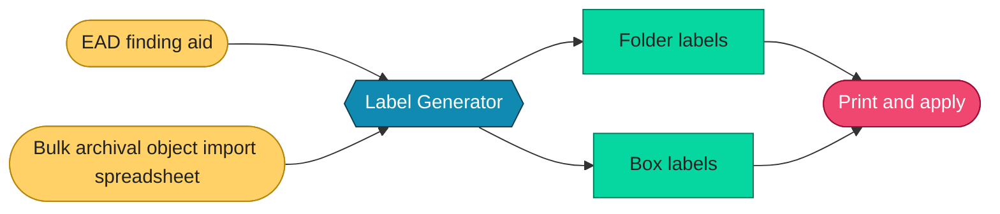

# Label Generator

- **Owner:** Will Nyarko
- **Date(s):**
  - Updated: 2026-10-11
- **Description:** Tool for generating archival folder and box labels.

The `Label Generator` allows Yale archival staff to generate ready-to-print folder and box labels.

It takes an EAD or a bulk archival object import spreadsheet as input to generate files that staff can easily print as labels to be applied on various standard and custom boxes and folders.

The current implementation of this tool supports the command line, desktop and web, each with its code and documentation:

- Command line: [`interfaces/cli`](interfaces/cli)
- Desktop: [`interfaces/desktop`](interfaces/desktop)
- Web: [`interfaces/web`](interfaces/web)

The files you can use to test the tool are found in [`testing-inputs`](testing-inputs).

> [!NOTE]
> This tool is optimized for the ArchivesSpace archival management system and for Yale, and it can be configured to fit a different system or institution.

> [!NOTE]
> The labels are formatted for Avery label stock and Word; you can adjust the formats to fit your own needs.
