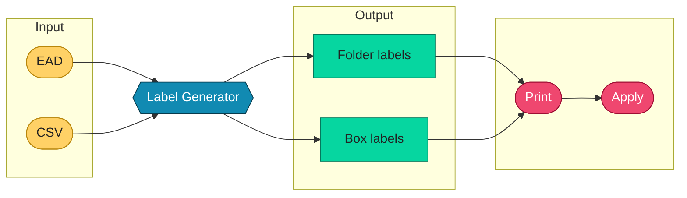

# Label Generator

- **Owner:** Will Nyarko
- **Date(s):**
  - Updated: 2026-11-24
- **Description:** Tool for generating archival folder and box labels.

Label Generator makes Word sheets of folder and box labels for Yale archival staff. It also exports the rows used to make those labels as CSV files.

Start with an EAD2002 or EAD3 finding aid, or a bulk import CSV in the ArchivesSpace-native or Yale-custom layout.

## Using Label Generator

- [Command-line tool](interfaces/cli/README.md) — make labels in a terminal.
- [Desktop app guide](interfaces/desktop/README.md) — make labels in the application window.

To try a collection and check the resulting labels, use the [sample inputs and expected results](testing-inputs/README.md).

> [!NOTE]
> This tool is optimized for the ArchivesSpace archival management system and for Yale, and it can be configured to fit a different system or institution.

> [!NOTE]
> The labels are formatted for Avery label stock and Word; you can adjust the formats to fit your own needs.
