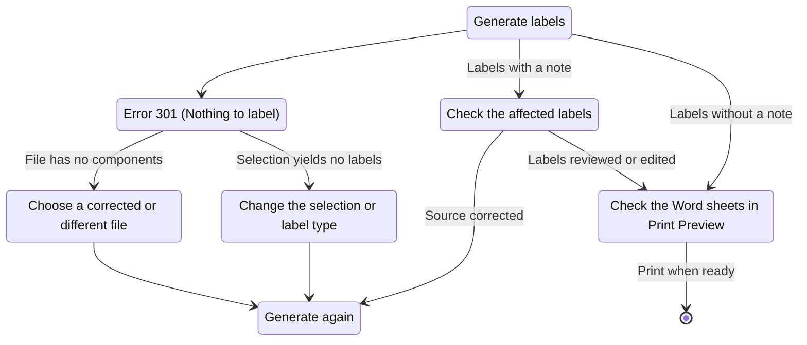

# How a label run ends and what to do next

If Error 301 stops a run, read the reason to decide whether to change the file or the selection. If labels come with a note, the Word sheets and CSV rows are ready for review.

## If Error 301 stops the run

- **The file has no components to label.** Choose a finding aid export that includes the components you need, or save a bulk import CSV with component rows. Run the generator again with that file.
- **The selection cannot produce the requested labels.** Keep the file and change the selected material or label type. For example, if you requested only box labels and the selected material has no source-supplied box number, you can request folder labels, select material with a box number, or choose a file that supplies one.

## If labels come with a note

Read each note before printing. For **Note 302 (Placeholder box number)**, search the Word sheets for `10001` and check each occurrence against the source and the material. Keep a genuine box 10001. Replace a placeholder when you know the box number. If there is no physical box, skip an unnecessary label or remove the placeholder from a folder label you plan to print.

For a one-time correction, edit a copy of the Word sheet and check it in Print Preview. To carry a correction into the CSV rows and future labels, correct the source, re-export it if needed, and generate again. [Staff workflow for reviewing and printing labels](staff-labeling-workflow.md)
