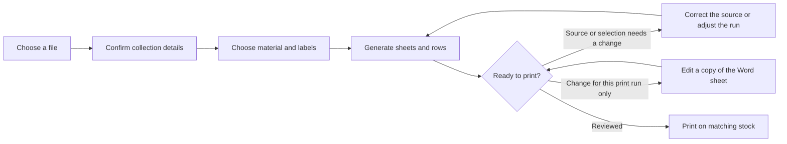

# From finding aid or spreadsheet to printed labels

## Prepare the labels

1. **Choose the file for the material in hand.** Use an ArchivesSpace EAD2002 or EAD3 finding aid (`.xml`), or a bulk import spreadsheet saved as CSV in the Yale-custom or ArchivesSpace-native layout.
2. **Confirm what will identify the collection.** Check the collection name and call number. For box labels, also check the repository. Supply missing details when you know them.
3. **Choose the print run.** Select the whole collection, particular boxes, or a top-level group such as a series. Choose folder labels, box labels, or both. If the boxes hold no folders, choose box labels alone and omit folder information. If the file leaves folder numbering open, follow the sequence on the folders.
4. **Generate the Word sheets and CSV rows.** Use the rows to check that the intended material is present. Selecting part of a collection preserves its folder numbers. For example, selecting box 2 for folder labels in the sample collection gives two folder rows. [Sample CSV](../testing-inputs/cases/test-2-csv-yale-custom.csv) · [Expected counts](../testing-inputs/expected/test-2.md)

## Review the sheets before printing

If the run stopped with Error 301 or produced labels with a note, see [How a label run ends and what to do next](label-run-outcomes.md).

Open the Word files in Print Preview. Check that the collection details and numbers match the material, and that longer titles and dates fit. Read any notes from the run.

If **Note 302** appears, search the Word sheets for **10001**. A single note can cover several placeholders. Keep any genuine box 10001. For an affected label, enter the known box number. If there is no physical box, omit an unnecessary label or remove the placeholder from a folder label you still need.

For a one-time correction, save an edited copy of the Word sheet and review it again. To carry a correction into future labels and CSV rows, correct the spreadsheet or finding aid, export the revised file as needed, and generate again.

For examples of a partial run and a genuine box 10001 alongside a placeholder, see [Folder numbers and box indicators on labels](label-ready-record.md).

## Print

| Word sheet | Avery stock |
| --- | --- |
| Folder labels | 5161 |
| Standard box labels, including full Hollinger and Paige | 5164 |
| Half Hollinger box labels (vertical text) or tall flat box labels (horizontal text) | 5163 |

Load the stock for the Word sheet you are printing. Choose **US Letter** and **Actual size (100%)**. If you need to check alignment, print one page on plain paper and hold it against a label sheet before printing the batch.
