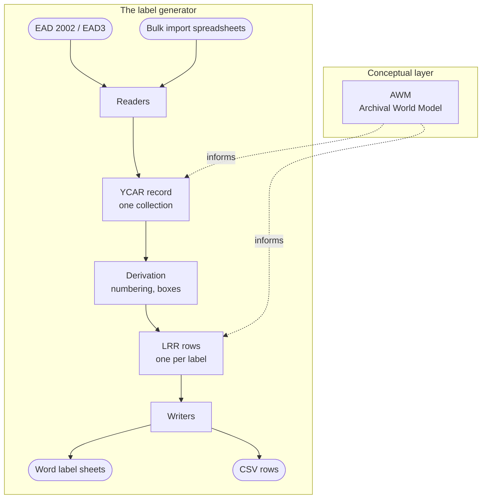

# AWM, YCAR and LRR

- **Owner:** Will Nyarko
- **Date(s):**
  - Updated: 2026-10-14
- **Description:** The three layers the label generator is built around: the Archival World Model, the Yale Canonical Archival Record and the label-ready record.

Archival processing, in both description and arrangement, expresses the same reality in many forms at once: the boxes and folders themselves, the finding aid that describes them, the spreadsheet that records them, the export a system produces, and the habits of the people doing the work. Each form carries part of that reality in its own terms, and it is often hard to see how a thing in one form relates to the same thing in another. Those gaps are where confusion and error enter.

The label generator is built to close those gaps for the task of making labels. Rather than teach every part of the program every form, it agrees on meaning once and holds to it, through a descent of three layers: a shared vocabulary for archival reality, one record of a collection, and the facts a single label needs. Every input meets in the middle and every output leaves from the bottom, so either end can change without disturbing the other, and the words used in code, in documentation and with staff stay the same.

## AWM: the Archival World Model

The AWM is a conceptual framework or a lightweight ontology for expressing an archival reality: collection, repository, call number, component, hierarchy, container, box, folder, title, date and the relations between them, no matter if it's a row in a bulk import spreadsheet, an element in an EAD file, some guidance rule about how to label, etc. The AWM provides a shared language for describing any system, workflow, policy or manual that touches archives, at a level above technical diagnostics and code. The label generator draws its concepts from the AWM even as none of the code makes references to it.

## YCAR: the Yale Canonical Archival Record

YCAR takes a small step downstream from the AWM, optimized for Yale's archival reality: its ArchivesSpace (ASpace) repositories and call numbering schemes, ASpace exports (in EAD2002 and EAD3), and the custom Yale and ASpace bulk import spreadsheets. For this project, a YCAR record describes one collection: its identity (collection name, call number, repository), its components and their nesting, and the containers that hold them. It is a reader's job to turn its input into a YCAR record, so that everything after reads from the same source no matter how the input came in.

## LRR: the label-ready record

An LRR holds everything one printed label needs. By the time an LRR is created, there is nothing left for the system to look up: one row per folder label, and one row per box label. LRR rows come from a YCAR record through derivation, where folders are numbered and boxes are counted, and the Word and CSV writers read only these rows. It can thus be seen as a convergence point: everything before it adapting inputs, and everything after it adapting outputs.

## The program as a system

