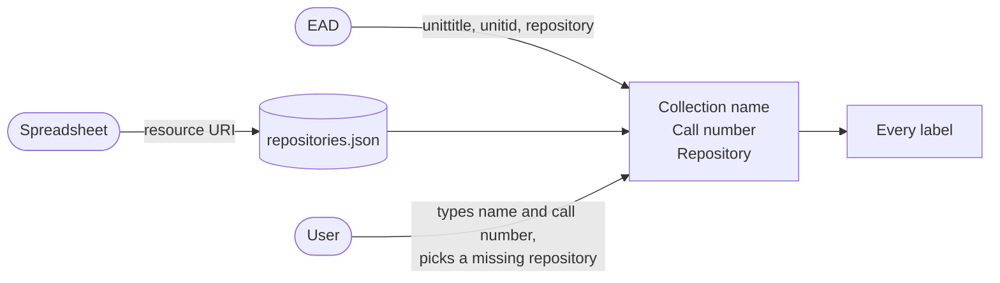
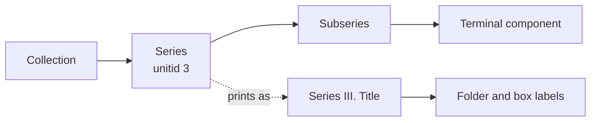
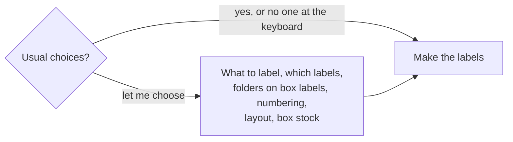
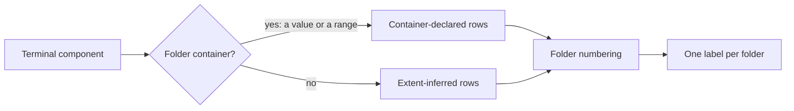
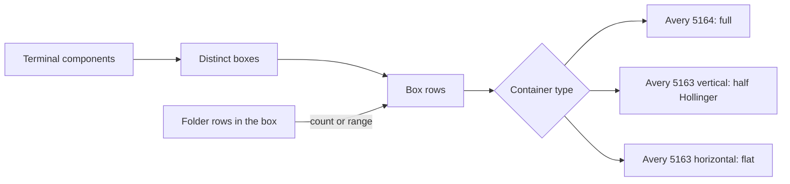
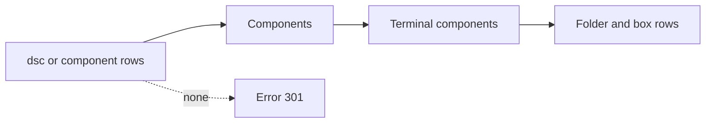
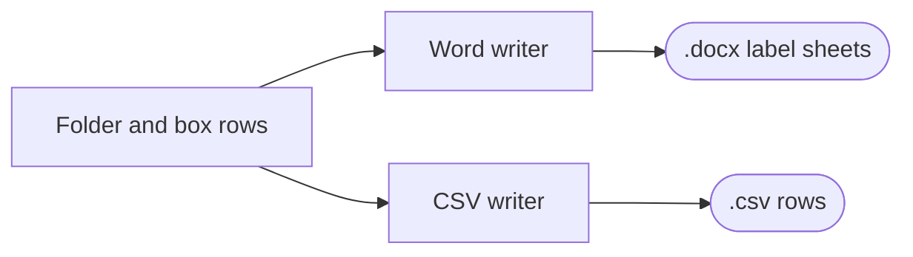
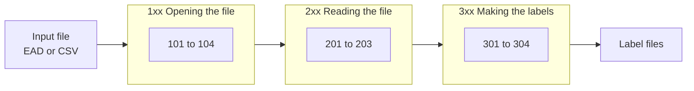

# Rules

- **Owner:** Will Nyarko
- **Date(s):**
  - Updated: 2026-10-14
- **Description:** The rules the label generator applies between reading an input and writing labels: identity, hierarchies, choices, containerization, what gets labelled, output files, guarantees and notices.

This document contains the rules (in descriptive prose) that the label generator system applies between reading an input source and writing an output label. Implementation files that apply the rules (as deterministic code) are in:

- `readers/detect.py` (notices)
- `readers/ead.py` (identity, hierarchies, notices)
- `readers/sheet.py` (identity, hierarchies)
- `repositories.py` (identity)
- `lrr/derive.py` (hierarchies, containerization, what gets labelled)
- `lrr/numbering.py` (containerization)
- `lrr/selection.py` (user choices)
- `lrr/box_kinds.py` (containerization)
- `pipeline.py` (user choices, what gets labelled, output files, notices)
- `projections/word.py` (output files)
- `projections/rows.py` (output files)
- `notices.py` (notices)
- `main.py` (identity, user choices)

## A. Identity

Certain EAD elements and spreadsheet fields allow us to know the unique identity context about the collections we're working with.

| Label field | From an EAD | From a bulk import spreadsheet |
| --- | --- | --- |
| Collection name | `<unittitle>` in the top-level `<did>` | what the user types |
| Call number | `<unitid>` in the top-level `<did>` | what the user types |
| Repository | `<repository>` in the top-level `<did>` | the repository number in the resource URI (`/repositories/11/resources/12345`), matched against `config/repositories.json` |

If, for the label generator, the input is a bulk import spreadsheet, the user will have to provide the collection name and the call number. It asks for each once, early in the run, and carries whatever the user types onto each label. If the user presses Enter instead, the labels show "Collection unavailable" or "Call number unavailable", and the run ends with note 303. Where no repository turns up, the program asks the user to pick one from the list in `config/repositories.json`. A run with no one at the keyboard shows "Repository unavailable" on the labels, followed by note 304.

## B. Hierarchies

Every folder sits somewhere in the hierarchy of its collection. The program keeps the full chain of ancestors above each terminal component, outermost first, and each link holds the ancestor's title. EAD and ArchivesSpace allow nesting up to twelve levels, and the EAD reader follows components to that depth.

An ancestor at `@level="series"` in an EAD, or level type "series" in a spreadsheet, appears as `Series {N}. Title` when it has a `unitid`:

- A whole-number `unitid` becomes a Roman numeral: `Series III. Artwork`.
- Any other `unitid` prints as written, and a `unitid` that already begins with "Series" keeps a single "Series".
- A title that already opens with "Series" and a number, such as `Series 1: Correspondence`, appears as exported.

Every other ancestor, such as a subseries, shows its title only. A folder label carries the outermost ancestor as its series line, followed by the ancestors below it joined with " / ". A box label carries the first top-level ancestor among the folders it holds.

## C. User Choices

Early in each run, the program offers the usual choices or a menu for each choice. The usual choices are the whole collection, folder and box labels, folders shown on box labels, numbering per box wherever the file leaves numbering open, left and right folder labels, and each box's label stock chosen by its container type. A run with no one at the keyboard takes the same choices.

A user who prefers to choose meets these menus in turn:

1. **What to label.** The whole collection, chosen boxes, or chosen series, subseries or other aggregates. The program numbers the whole collection first and only then keeps the chosen part, which means a label reads the same whichever part a run covers. Because a box label describes the entire box, a chosen folder brings its box label in full.
2. **Which labels.** Folder and box labels, folder labels only, or box labels only.
3. **Folders on box labels.** Shown: each box label ends with the folder range or count. Left off: box labels end at the box line, and folder labels stay as they are. Box labels only with folders left off suits boxes that hold no folders.
4. **Folder numbering.** Per box, or one count through the collection, which starts at a number the user supplies if the file has no folder numbers. This question comes up only when a label shows folder numbers and the file's own numbers leave the scheme open (see D. Containerization).
5. **Folder label layout.** Left and right labels, or left labels only.
6. **Box label stock.** Each box's stock chosen by its container type, or one kind of box for the whole run.

## D. Containerization

Containers carry the physical side of a collection: the boxes on the shelf and the folders inside them. The program builds one row per physical folder and one per box, and each label comes from those rows.

### Folder rows

A terminal component whose containers include a folder is **container-declared**. Any other is **extent-inferred**.

| Origin | Rows produced |
| --- | --- |
| Container-declared, single value | One row with the folder value as written. A non-numeric value such as `1A-1C` stays as written. |
| Container-declared, range (`1-3`, `Folder 1 - Folder 3`) | One row per folder, titled `[1 of 3]`, `[2 of 3]`, `[3 of 3]`. A range that runs backwards stays one row. |
| Extent-inferred, extent in folders (`3 folders`) | One row per folder, titled `[i of N]`, numbered later. |
| Extent-inferred, any other extent or none | One row, numbered later. |

Only an extent whose unit is folders counts folders. A terminal component whose containers give no box number goes into the sentinel box `10001`, and the run ends with note 302 (missing-box).

Each physical folder takes one label: rows that name the same folder in the same box collapse to the first in shelf order. Shelf order runs box then folder, in natural order: `2` before `10`, and `2` before `2A`.

| Folder row field | Source |
| --- | --- |
| `box` | the box container's number; otherwise the number of another container that is not a folder; `10001` when there is none |
| `folder` | the folder number the file gives, or the one the program assigns |
| `container_type` | the first container's type (`altrender` in EAD2002, `encodinganalog` in EAD3, the container profile or type in a spreadsheet) |
| `folder_title` | the component title, with `[i of N]` when one component spans several folders |
| `folder_dates` | the component's first date; `Date unavailable` when it has none |
| `ancestors` | the ancestor titles above, outermost first |

### Folder numbering

The program settles the numbering scheme in this order:

- **The file's own scheme.** Where the file carries folder numbers in two or more boxes, those numbers show the scheme. A number that appears in more than one box means numbering starts again in each box. One count with no repeats means it runs through the collection. That scheme applies, and no question comes up.
- **The user's choice.** Otherwise the user chooses per box or one count through the collection, as in C. User Choices.
- **The first folder.** With one count through the collection and no folder numbers in the file, the count begins at the number the user supplies (1 by default), letting a new accession continue an older collection's count.

When it assigns numbers:

- **Scope.** Per-box numbering starts again in each box. Numbering through the collection runs in box order.
- **After the file's numbers.** An unnumbered folder takes the next number after the highest one the file carries in its scope. Each folder in a scope thus has its own number.
- **Display prefix.** A value written as "Folder 3" reads as `3`.

### Box rows

Box rows come from the boxes of terminal components, one row per distinct box in natural order, and the folder rows in each box then fill them in. Because they start from the components' boxes, a box-only run works from the boxes alone.

| Box row field | Source |
| --- | --- |
| `box` | the distinct box value |
| `folder_count` | `N folder(s)` for the folders in the box; empty when there are none |
| `first_folder` / `last_folder` | the lowest and highest folder numbers in the box, when folders run in one count through the collection and every number in the box begins with digits; a number such as `2A` counts as `2`, and `last_folder` stays empty when it equals `first_folder` |
| `container_type` | the first container type found for the box |
| `all_series` | the distinct top-level ancestors of the components in the box, in the order found; the label prints the first |

With folders left off box labels, the box rows leave `FOLDER_COUNT`, `FIRST_FOLDER` and `LAST_FOLDER` empty, so that a later mail merge cannot bring back what the run left off.

### Box label stock

Each box goes to a label stock by its container type, unless the user chooses one kind of box for the whole run. The kinds, their sheets, the container types and the height threshold live in `config/box_kinds.toml`.

| Stock | Chosen for |
| --- | --- |
| Avery 5164 (`full`) | full Hollinger and Paige boxes, and any container type not listed below |
| Avery 5163, vertical (`half-hollinger`) | `archive half legal` and `archive half letter` |
| Avery 5163, horizontal (`flat`) | a container type beginning "flat box" whose height is above 2 inches, such as `flat box (14d 3h 18w)` |

Every sheet holds two labels across.

## E. What gets labelled

A terminal component is a `<c>` or `<cNN>` component of an EAD's `<dsc>`, or a component row of a spreadsheet, with no component beneath it: the leaf of a descriptive branch. Every terminal component produces labels, whatever its containers say. One with no box number goes into the sentinel box `10001`, and its folders come from a folder container, an extent in folders, or a single folder.

An EAD whose `<dsc>` holds no c components, or a spreadsheet with no component rows, leaves nothing to label, and the run stops with error 301. A run for box labels alone stops the same way if every chosen box is `10001`.

## F. Output files

Every run writes Word label sheets and CSV rows beside the input file. A file picked from Downloads gets copied into the program's folder first, and the labels land there.

| File | Written when |
| --- | --- |
| `<stem>_folder_labels.docx`, or `<stem>_left_labels.docx` for left labels only | the run makes folder labels |
| `<stem>_box_labels.docx`, `<stem>_box_labels_half_hollinger.docx`, `<stem>_box_labels_flat.docx` | the run makes box labels on that stock |
| `<stem>_folder_rows.csv`, `<stem>_box_rows.csv` | the run makes folder or box labels |

The stem joins the collection name, cut to 40 characters, and the call number, cut to 20, with an underscore. Accented letters lose their accents, and any character other than a letter, digit, `.`, `_` or `-` becomes `_`. A run for part of a collection adds the choice to the stem, such as `_boxes_12-15`.

## G. Guarantees

- A label reads the same in every run: the program derives and numbers the whole collection first, and a choice of boxes or aggregates then keeps part of it.
- Every terminal component produces labels.
- A run with no one at the keyboard, or one where the user picks the usual choices, takes the usual choices listed in C. User Choices.
- A run for box labels alone, in which every box is `10001`, stops with error 301 (nothing-to-label).
- Leaving folders off box labels leaves folder labels as they are.

## H. Notices

Notices tell a user something they need to know about a file that they want to generate labels from. There is an **error** notice, which not only tells but actually stops the run and writes nothing because the program cannot proceed, and a mere **note**, which doesn't stop the run but alerts the user after the labels have been made, before they print. The rule for any new notice: **stop the run only when no useful label could come out, and otherwise add a note and go on.**

For more details about notices, refer to [notices.md](notices.md).
